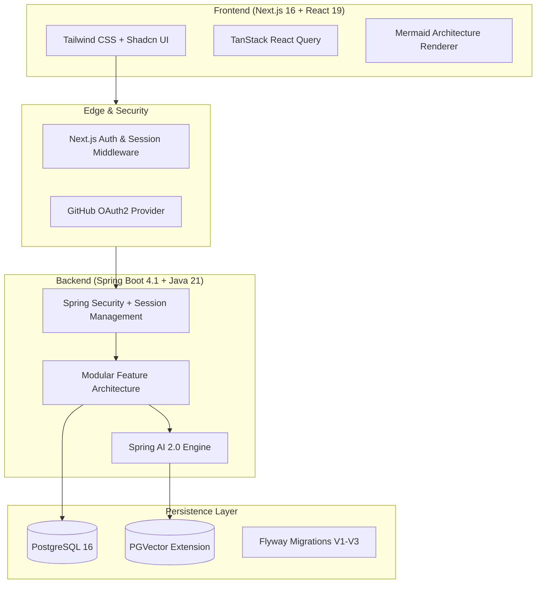
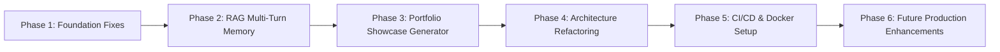
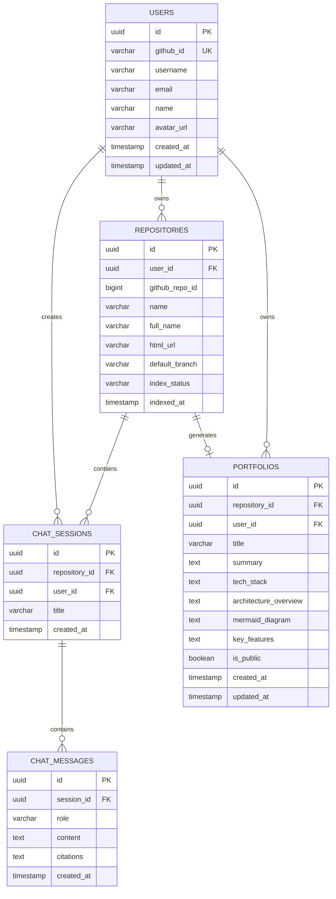

# Buildfolio — Production Architecture & Phase-Wise Implementation Roadmap

## 1. Executive Summary & Overview
**Buildfolio** is a developer platform that connects to GitHub repositories, indexes code into vector embeddings with PostgreSQL PGVector, powers a multi-turn RAG chat assistant, and automatically synthesizes developer portfolios and architectural showcases with Mermaid diagrams.

This document serves as the master implementation reference, capturing all architectural decisions, directory structures, database schemas, and the complete phase-by-phase execution plan.

---

## 2. System Architecture & Tech Stack



### Tech Stack Details:
| Tier | Technology | Purpose |
| :--- | :--- | :--- |
| **Backend Framework** | Spring Boot 4.1.1 + Java 21 | High-concurrency core REST APIs, SSE streaming |
| **AI & LLM Engine** | Spring AI 2.0.1 (OpenAI GPT-4o / GPT-4o-mini) | RAG code assistant, portfolio synthesis, Mermaid generation |
| **Database** | PostgreSQL 16 + PGVector | Relational persistence & vector similarity search |
| **Database Versioning**| Flyway Migrations | Automated schema evolution (`V1__...`, `V2__...`, `V3__...`) |
| **Frontend Framework**| Next.js 16 (App Router) + React 19 | Server & Client Components, Standalone SSR production build |
| **Styling & UI** | Tailwind CSS + Lucide Icons + Shadcn UI | Responsive developer-first design |
| **State & Fetching** | TanStack React Query v5 | Reactive cache, mutations, optimistic updates |
| **Containerization** | Docker (Multi-stage) + Docker Compose | Containerized build, deployment, and testing orchestration |
| **CI/CD** | GitHub Actions | Automated linting, testing, and production builds |

---

## 3. Modular Backend Architecture (Feature-First + Subfolders)

Every business domain is encapsulated in its own package. Inside each feature package, concerns are partitioned into explicit subfolders:

```
backend/src/main/java/com/buildfolio/backend/
├── BackendApplication.java
│
├── common/                                 # Cross-Cutting Shared Modules
│   ├── config/                             # AppConfig, CorsConfig, CryptoConfig, SecurityConfig
│   ├── security/                           # CurrentUser, AppUserPrincipal, GithubOAuth2UserService
│   └── exception/                          # GlobalExceptionHandler, BadRequestException, NotFoundException, UnauthorizedException
│
├── auth/                                   # Authentication & GitHub User Lifecycle
│   ├── controller/                         # AuthController.java
│   ├── service/                            # UserService.java
│   ├── repository/                         # UserRepository.java
│   ├── entity/                             # User.java
│   └── dto/                                # UserResponse.java
│
├── repo/                                   # GitHub Repository Management
│   ├── controller/                         # RepoController.java
│   ├── service/                            # RepoService.java
│   ├── repository/                         # RepositoryRepository.java
│   ├── entity/                             # Repository.java, IndexStatus.java
│   └── dto/                                # RepositoryResponse.java, IndexStatusResponse.java
│
├── indexing/                               # Code Parsing & Vector Embedding Ingestion
│   └── service/                            # IndexingService.java, CodeChunker.java, CodeFileFilter.java
│       └── github/                         # GitHubRateLimiter.java, GithubApiClient.java, GithubApiException.java
│
├── chat/                                   # Multi-Turn RAG Code Assistant
│   ├── controller/                         # ChatController.java
│   ├── service/                            # ChatService.java
│   │   └── ai/                             # ChatPromptBuilder.java, ChatStreamHandler.java, CodeContextRetriever.java, CitationMapper.java
│   ├── repository/                         # ChatMessageRepository.java, ChatSessionRepository.java
│   ├── entity/                             # ChatMessage.java, ChatSession.java, MessageRole.java
│   └── dto/                                # ChatMessageRequest.java, ChatMessageResponse.java, ChatSessionResponse.java
│
├── portfolio/                              # AI Developer Portfolio & Architecture Showcase
│   ├── controller/                         # PortfolioController.java
│   ├── service/                            # PortfolioService.java
│   ├── repository/                         # PortfolioRepository.java
│   ├── entity/                             # Portfolio.java
│   └── dto/                                # PortfolioResponse.java, UpdatePortfolioVisibilityRequest.java
│
└── health/                                 # Health Probes & Monitoring
    └── controller/                         # HealthController.java
```

---

## 4. Phase-Wise Implementation Roadmap



---

### Phase 1: Production Foundation Hardening ✅ (Completed)
- **Objective**: Fix critical blocking bugs in migrations, Docker volumes, session cookies, and error handling.
- **Key Deliverables**:
  1. **Flyway Migration Naming**: Renamed `V1.init_schema.sql` to standard Flyway convention `V1__init_schema.sql` (two underscores) so migrations execute on startup.
  2. **Docker Compose Path Correction**: Updated `./docker-postgres/init-extensions.sql` to `./docker/postgres/init-extensions.sql`.
  3. **Custom Session Cookie Configuration**: Standardized `server.servlet.session.cookie.name=BUILDFOLIO_SESSION` matching logout deletion logic.
  4. **Next.js Middleware Migration**: Replaced non-standard `client/proxy.ts` with standard Next.js `client/middleware.ts`.
  5. **Global Exception Handling**: Added structured JSON error handler for `NotFoundException`, `BadRequestException`, `UnauthorizedException`, `GithubApiException`, and input validation violations.

---

### Phase 2: Multi-Turn Conversation Memory for Code Chat ✅ (Completed)
- **Objective**: Upgrade the single-turn RAG assistant into a context-aware conversational agent.
- **Key Deliverables**:
  1. **Prompt Engineering for Conversation History**: Enhanced `ChatPromptBuilder.java` to format past turns inside `<conversation_history>` blocks.
  2. **Turn Fetching in ChatService**: Updated `ChatService.java` to retrieve the recent 8 messages of a session before assembling the retrieval-augmented LLM prompt.
  3. **Unit Tests**: Added `ChatPromptBuilderTest.java` verifying conversation history formatting and guardrail prompts.

---

### Phase 3: AI Developer Portfolio & Architecture Showcase ✅ (Completed)
- **Objective**: Enable developers to automatically synthesize a public/private portfolio and technical architecture showcase for their indexed repositories.
- **Key Deliverables**:
  1. **Database Migration `V3__create_portfolios_table.sql`**: Added `portfolios` table storing title, summary, JSON tech stack, architecture overview, Mermaid diagram, key features, and visibility flag.
  2. **Portfolio Entity & Repositories**: Implemented `Portfolio.java` and `PortfolioRepository.java` with query methods for owner access and public sharing.
  3. **Spring AI RAG Synthesis**: Created `PortfolioService.java` performing contextual codebase vector searches and prompting the LLM to output structured JSON with Mermaid diagrams.
  4. **Public & Private APIs**:
     - `POST /api/repos/{id}/portfolio/generate` — Generate or re-generate showcase.
     - `GET /api/repos/{id}/portfolio` — Fetch owner showcase.
     - `PATCH /api/repos/{id}/portfolio/visibility` — Toggle public sharing link.
     - `DELETE /api/repos/{id}/portfolio` — Reset/delete showcase.
     - `GET /api/public/portfolios/{id}` — Unauthenticated public showcase view.
  5. **Frontend Showcase UI**:
     - Created `client/components/portfolio/portfolio-showcase.tsx` with tabs: Architecture & Mermaid diagram, Tech Stack breakdown, Key Features list, Markdown export, and shareable link.
     - Created owner page at `/dashboard/repos/[repoId]/portfolio` and public page at `/portfolio/[id]`.

---

### Phase 4: Production File Structure Refactoring ✅ (Completed)
- **Objective**: Move away from flat, horizontal layers (`controllers/`, `services/`, `repository/`) into an industry-standard **Feature-First + Layered Subfolder** structure.
- **Key Deliverables**:
  1. Organized all code under `auth/`, `repo/`, `indexing/`, `chat/`, `portfolio/`, `health/`, and `common/`.
  2. Divided every domain into `controller/`, `service/`, `repository/`, `entity/`, and `dto/`.
  3. Safely migrated and updated all imports across 89 files.
  4. Verified package-level tests and verified clean build tree.

---

### Phase 5: Containerization & CI/CD Pipeline ✅ (Completed)
- **Objective**: Provide automated continuous integration testing and production-grade container builds.
- **Key Deliverables**:
  1. **GitHub Actions CI (`.github/workflows/ci.yml`)**:
     - Automated backend workflow with Java 21 Temurin and a live `pgvector:pg16` service container.
     - Automated frontend workflow with Node 20, pnpm caching, linting, and Next.js production build.
  2. **Multi-Stage Dockerfiles**:
     - `backend/Dockerfile`: Multi-stage build using `eclipse-temurin:21-jdk` (builder) and `eclipse-temurin:21-jre` (minimal runtime) running under a secure non-root user.
     - `client/Dockerfile`: Multi-stage build leveraging Next.js `output: "standalone"` on `node:20-alpine`.
  3. **Docker Compose Orchestration (`docker-compose.yml`)**:
     - Unified orchestration of `postgres` (with PGVector), `backend`, and `client` over a isolated bridge network.
  4. **Environment Specification (`.env.example`)**: Clear template for all required production variables.

---

### Phase 6: Advanced Production Enhancements ✅ (Completed)
- **Objective**: Extend developer empowerment with automated documentation PRs, codebase security audits, and real-time streaming.
- **Key Deliverables**:
  1. **Portfolio PDF & Social Card Exporter**:
     - Added one-click PDF printing and clean Markdown documentation bundle downloads.
  2. **GitHub Architecture PR Generator**:
     - `POST /api/repos/{id}/portfolio/export-pr` automatically forks a new branch, writes `docs/ARCHITECTURE.md`, and submits a pull request with an architectural breakdown and Mermaid diagram to GitHub.
  3. **Repository Health & Security Static Analyzer**:
     - DB Migration `V4__create_security_audits_table.sql`.
     - `SecurityAuditService.java` scans indexed codebase against CISO standards to detect security posture, vulnerabilities, and hardening recommendations.
     - Interactive UI at `/dashboard/repos/[repoId]/audit`.
  4. **Real-Time Indexing Progress SSE Broadcaster**:
     - Added `IndexingProgressBroadcaster.java` with `/api/repos/{id}/index-stream` SSE streaming file-by-file progress directly to connected clients.
  5. **AI Code Refactoring & "Fix Vulnerability" PR Generator**:
     - `POST /api/repos/{id}/audit/fix` inspects targeted vulnerabilities, fetches the corresponding source files, prompts Spring AI for secure remediations, creates a dedicated branch (`buildfolio-sec-fix-...`), commits the fixed code, and opens a GitHub Pull Request with clear explanations.
  6. **Live Frontend SSE Indexing Progress Bar**:
     - Replaced polling with `useIndexProgressStream` hook subscribing to `/api/repos/{id}/index-stream` for live file-by-file animation.
  7. **Interactive Mermaid.js Diagram Viewer**:
     - Embedded `MermaidDiagramViewer` with pan, zoom controls (60% to 200%), and SVG vector export.
  8. **Multi-Repo Comparative Architecture & Tech Stack Matrix**:
     - `POST /api/repos/compare` and interactive `/dashboard/compare` view providing side-by-side polyglot matrix and cross-architecture AI synergy evaluation.

---

## 5. Database Schema Reference



---

## 6. How to Run & Verify Locally

### Step 1: Start PostgreSQL with PGVector
```bash
docker compose up -d postgres
```

### Step 2: Configure Environment
Copy `.env.example` to `.env` and provide your GitHub OAuth and OpenAI API keys:
```bash
cp .env.example .env
```

### Step 3: Run Backend
```bash
cd backend
./mvnw clean spring-boot:run
```
Backend will be available on `http://localhost:8080`.

### Step 4: Run Frontend
```bash
cd client
pnpm install
pnpm dev
```
Client will be available on `http://localhost:3000`.

### Step 5: Run Full Stack via Docker
```bash
docker compose up --build
```
